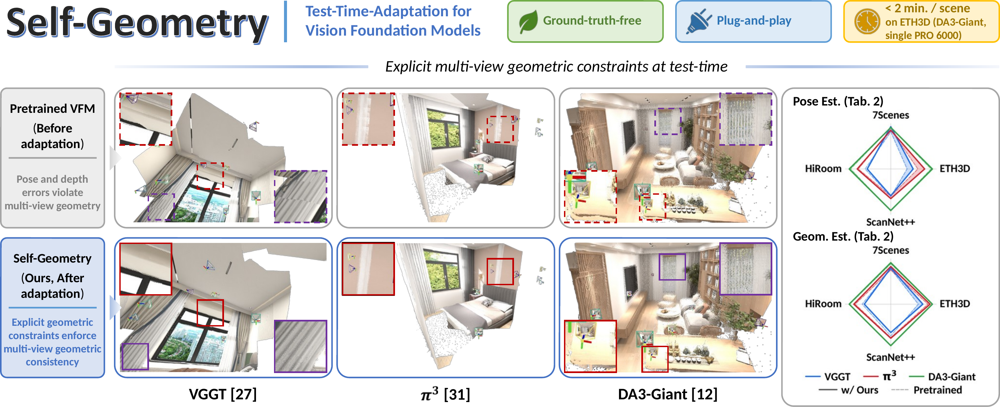
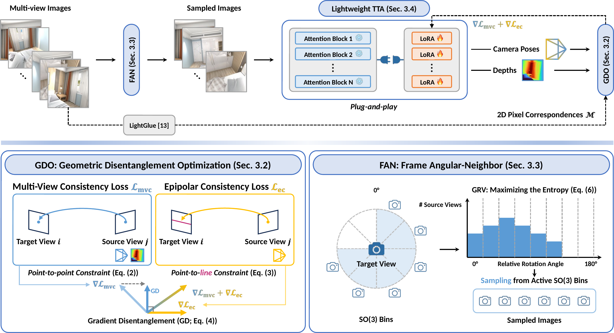

<h1>
  
  Self-Geometry: GT-Free and Plug-and-Play Test-Time Adaptation for Geometrically Consistent 3D Vision Foundation Models
</h1>

**<a href="https://github.com/sh25youn2">Seokhyun Youn</a>**<sup>1</sup>,
**<a href="https://github.com/rpdahxn">Dahyeon Kye</a>**<sup>1</sup>,
**<a href="https://scholar.google.com/citations?user=RfIHcSoAAAAJ&hl=en">Ziyu Wan</a>**<sup>2</sup>,
**<a href="https://scholar.google.com/citations?user=EULut5oAAAAJ&hl=ko">Sung-Ho Bae</a>**<sup>3†</sup>,
**<a href="https://github.com/JihyongOh">Jihyong Oh</a>**<sup>1†</sup>
<br>

<sup>1</sup>Creative Vision and Multimedia Lab (CMLab), Chung-Ang University
<sup>2</sup>Microsoft Research
<sup>3</sup>Efficient Neural Computing Lab (ENC Lab), Kyung Hee University
<br>
†Corresponding authors

[](https://cmlab-korea.github.io/Self-Geometry/)
[](https://arxiv.org/abs/2608.10708)


This repository is the official PyTorch implementation of
**"Self-Geometry: GT-Free and Plug-and-Play Test-Time Adaptation for Geometrically Consistent 3D Vision Foundation Models."**



---

## News

- **2026.11.27**: The [project page](https://cmlab-korea.github.io/Self-Geometry/) is updated with an overview video, a demo video, interactive 3D examples, and qualitative results.
- **2026.08.07**: Self-Geometry [Project page](https://cmlab-korea.github.io/Self-Geometry/) is initially released.

---

<details>
<summary><b>Abstract</b></summary>
<br>

Recent **vision foundation models (VFMs)** predict camera poses and dense scene geometry in a single forward pass without per-scene optimization and achieve strong performance across diverse benchmarks.
However, these models predict without enforcing explicit multi-view geometric constraints, and **multi-view geometric inconsistency** can therefore arise in their predictions.
To address this inconsistency, a recent test-time adaptation method adapts the model through feature-level self-distillation, but leaves explicit multi-view geometric constraints unenforced.
In this paper, we propose **Self-Geometry**, a **plug-and-play test-time adaptation (TTA) pipeline** that directly imposes explicit multi-view geometric constraints using **2D pixel correspondences** as **pseudo ground truth**.
Our Self-Geometry consists of

- **Geometric Disentanglement Optimization (GDO)**, which combines the *multi-view consistency* and *epipolar consistency* losses with *gradient disentanglement* to resolve the gradient conflict between them;
- **Frame Angular-Neighbor (FAN)**, a view sampler based on SO(3) geodesic distances that reduces the cost of adaptation;
- **Lightweight TTA**, which adapts the pretrained models via **low-rank adaptation (LoRA)**.

Our Self-Geometry improves both pose estimation and geometry estimation on average across **six VFMs** (VGGT, π³, DA3-Giant/Large/Base/Small) and **four benchmarks** (7Scenes, ETH3D, ScanNet++, HiRoom).

</details>

<details>
<summary><b>Method Overview</b></summary>
<br>



Self-Geometry imposes explicit multi-view geometric constraints on a pretrained VFM, using 2D pixel correspondences extracted at test time by an external feature matcher (LightGlue) as pseudo ground truth. It consists of three complementary components:

| Component | Name | Description |
|-----------|------|-------------|
| **GDO** | Geometric Disentanglement Optimization | Formulates the constraints as the *point-to-point* MVC Loss (Eq. 2) and the *depth-independent point-to-line* EC Loss (Eq. 3), and applies Gradient Disentanglement (GD, Eq. 4) to resolve the *gradient conflict* that can arise between the two losses. |
| **FAN** | Frame Angular-Neighbor | Samples a subset of *angularly diverse* views using *scene-scale-invariant* SO(3) geodesic distances (Eq. 5), with the target view selected by *Geometry-Rich View Selection* (GRV, Eq. 6). This reduces the cost of each TTA iteration and maintains uniform coverage of the 3D scene. |
| **Lightweight TTA** | LoRA-based Per-Scene Adaptation | Inserts LoRA into the QKV weights of the attention blocks of the pretrained VFM. Only the LoRA parameters are updated and the pretrained VFM stays frozen, which preserves the geometric prior acquired during pretraining. Per-scene adaptation completes within a few minutes on a single NVIDIA RTX PRO 6000. |

Together, these components operate as a **GT-free**, **Teacher-free**, **Plug-and-play**, and **Explicit-Geometry** TTA pipeline.

</details>

---

## Code Release

**Code will be released soon.** In the meantime, please visit our
[project page](https://cmlab-korea.github.io/Self-Geometry/) for interactive pointmap /
depth-map comparisons, quantitative and qualitative results.

---

## Results

Please visit our [project page](https://cmlab-korea.github.io/Self-Geometry/) for:

- **Overview Video**: the multi-view geometric inconsistency of a pretrained VFM, the 2D pixel correspondences used as pseudo ground truth, and the EC Loss, the MVC Loss, and GD.
- **Demo Video**: geometry error maps of the six VFMs before and after Self-Geometry, and a comparison with TCO, Free-Geometry, and global alignment (GA).
- **Interactive Examples**: a side-by-side 3D viewer of geometry error maps on four scenes (ETH3D, HiRoom, ScanNet++), comparing Self-Geometry with the pretrained VFM, TCO, Free-Geometry, and GA.
- **Qualitative Results**: depth, geometry, and camera pose results on the four benchmarks, with one image per method.
- **Quantitative Results**: pose (AUC@3, AUC@30) and geometry (F1-score w/o p. / w/ p.) across all six VFMs and four benchmarks.

---

## Acknowledgement

We sincerely thank the authors of [VGGT](https://github.com/facebookresearch/vggt),
[π³](https://github.com/yyfz/Pi3), and [Depth Anything 3](https://github.com/ByteDance-Seed/depth-anything-3)
for releasing their pretrained models, and the authors of
[Free-Geometry](https://github.com/CMLab-Korea/Free-Geometry) and
[TCO](https://github.com/microsoft/moge) for their public baselines.
We also thank the authors of [LightGlue](https://github.com/cvg/LightGlue) and
[LoRA](https://github.com/microsoft/LoRA) for their excellent foundational tools.

Our project-page template is adapted from [Depth Anything 3](https://depth-anything-3.github.io/).

---

## Citation

```bibtex
@article{youn2026selfgeometry,
  title   = {Self-Geometry: GT-Free and Plug-and-Play Test-Time Adaptation for Geometrically Consistent 3D Vision Foundation Models},
  author  = {Seokhyun Youn and Dahyeon Kye and Ziyu Wan and Sung-Ho Bae and Jihyong Oh},
  journal = {arXiv preprint arXiv:2608.10708},
  year    = {2026},
}
```

---

## Star History

<a href="https://www.star-history.com/?repos=CMLab-Korea%2FSelf-Geometry&type=date&legend=top-left">
 <picture>
   <source media="(prefers-color-scheme: dark)" srcset="https://api.star-history.com/chart?repos=CMLab-Korea/Self-Geometry&type=date&theme=dark&legend=top-left&sealed_token=Xuf7F1VaXxRUF0S8wX9hhlqk9EMJjPY_-kFMJWXw9hKfujc9OWJXnt_JI3_0MJDZojaQLby7NJuIeKU635L8fv_eqgdZz9BAoyr_qGnPyEsy3_bWMtLZLQ" />
   <source media="(prefers-color-scheme: light)" srcset="https://api.star-history.com/chart?repos=CMLab-Korea/Self-Geometry&type=date&legend=top-left&sealed_token=Xuf7F1VaXxRUF0S8wX9hhlqk9EMJjPY_-kFMJWXw9hKfujc9OWJXnt_JI3_0MJDZojaQLby7NJuIeKU635L8fv_eqgdZz9BAoyr_qGnPyEsy3_bWMtLZLQ" />
   
 </picture>
</a>
